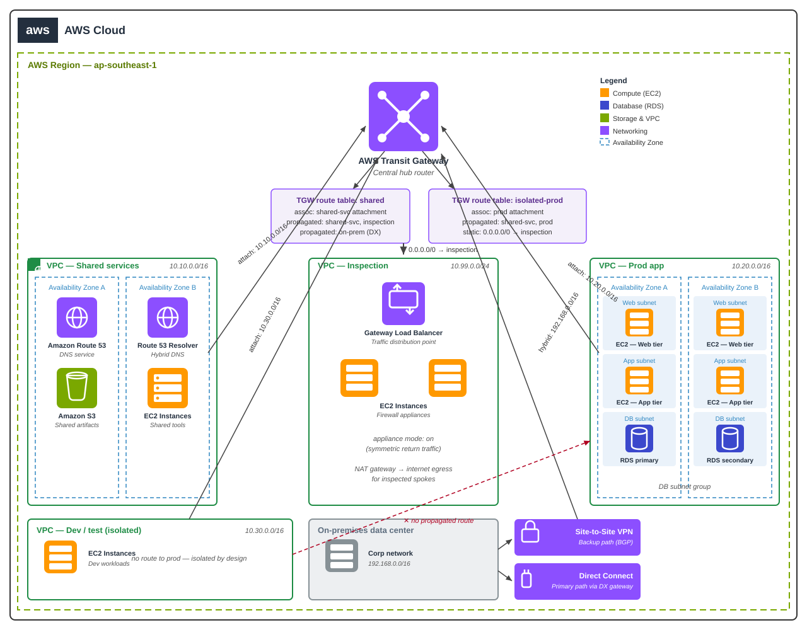

# AWS Transit Gateway Guide — One Router to Rule Your Cloud Network


> **TL;DR:** The moment you have more than a couple of VPCs, **VPC peering
> turns into a mesh of pain** — N×(N−1)/2 connections, route tables edited
> everywhere, no transitive routing, no central inspection. **Transit
> Gateway** replaces all of that with one managed hub router: attach VPCs,
> VPNs, and Direct Connect once, then control *who can reach whom* with
> **transit gateway route tables** (association = "which table do *I*
> use", propagation = "which tables learn *my* routes"). Default to
> **custom route tables with association/propagation disabled**, segment
> prod/dev/shared into isolated tables, funnel east-west traffic through
> an **inspection VPC**, and remember the bill has two knobs: **per
> attachment-hour + per GB processed**.

## The problem peering can't solve

Two VPCs? Peering is fine — one connection, two route entries, done.
Ten VPCs across three accounts plus an on-prem data center? That's 45+
peering connections, and peering is **not transitive**: VPC-A → VPC-B →
VPC-C requires peering between A and C too. Every new VPC means touching
every other VPC's route tables. And if security wants all inter-VPC
traffic inspected, there's no clean choke point to put a firewall.

Transit Gateway is a **regional, highly-available managed router**. Each
VPC (or VPN, or Direct Connect, or SD-WAN appliance) attaches *once*.
Routing between attachments is decided centrally by TGW route tables —
which is exactly the separation of concerns a network team wants: app
teams manage their VPCs, the platform team owns the hub.

## Transit Gateway vs the alternatives

| | Transit Gateway | VPC peering | Direct Connect gateway | PrivateLink (VPC endpoints) |
| --- | --- | --- | --- | --- |
| Transitive routing | Yes (hub) | No | Yes (on-prem ↔ VPCs) | N/A (service consumer model) |
| VPC ↔ VPC at scale | One attachment per VPC | N×(N−1)/2 peerings | Not for VPC↔VPC | Per-service endpoints |
| Cross-account / multi-region | RAM share / TGW peering | Per-pair, same region only | DXGW associations | Cross-region endpoints possible |
| Central traffic inspection | Yes (inspection VPC) | No clean choke point | No | No |
| On-prem connectivity | VPN, DX, Connect (SD-WAN) | No | DX only | No |
| Cost profile | Attachment-hours + $/GB processed | $/GB data transfer | DX port + virtual interfaces | Endpoint-hours + $/GB |
| Best for | 3+ VPCs, hybrid, central control | 2 VPCs, simple, same region | On-prem ↔ many VPCs via DX | Exposing a *service*, not a network |

**Default choice: Transit Gateway** once you have 3+ VPCs, multiple
accounts, or any on-prem link. Stay on peering only for the genuinely
simple case — two VPCs, one region, no inspection requirement.

## Architecture



Traffic flow, step by step:

1. **Spoke VPCs attach once** — prod, dev, and shared-services VPCs each
   get a TGW attachment in their own subnets (one per AZ for
   resilience). The VPC route tables point inter-VPC CIDRs at the
   attachment (`pcx-` is peering; here it's `tgw-attach`).
2. **Association decides the spoke's view** — the prod attachment is
   *associated* with the `isolated-prod` TGW route table, so prod's
   traffic only follows prod's routes. The shared-services attachment
   uses the `shared` table.
3. **Propagation decides who learns what** — the shared-services VPC's
   CIDR is *propagated* into both `shared` and `isolated-prod` tables
   (everyone needs DNS/tools), but prod's CIDR is propagated *only* into
   `isolated-prod` and the inspection table — dev never learns a route
   to prod, so dev → prod is impossible at the network layer, not just
   by security-group convention.
4. **Inspection VPC in the middle** — `isolated-prod` has a default
   route (`0.0.0.0/0`) pointing at the inspection attachment. All
   east-west traffic hairpins through Gateway Load Balancer endpoints to
   firewall appliances (enable **appliance mode** on the attachment so
   return traffic is symmetric). North-south internet egress also exits
   here through a NAT gateway — one place for logging, TLS inspection,
   and IDS.
5. **Hybrid on the same hub** — the data center connects via Direct
   Connect gateway (steady traffic) and a VPN backup. Its routes are
   propagated into the tables that need on-prem, and nothing else.
   SD-WAN branches use **Connect attachments** (GRE + BGP) on the same
   TGW.
6. **DNS that actually resolves** — Route 53 Resolver endpoints in the
   shared-services VPC, with forwarding rules shared via RAM, so
   `db.internal` resolves from every spoke and on-prem.

## Core concepts (one minute each)

### Association vs propagation — the two verbs of TGW routing

This is the single most-tested concept. Memorize it as:

- **Association** — "which route table do *I* look at?" Each attachment
  is associated with exactly one TGW route table. When a packet arrives
  from that attachment, the TGW consults *its* associated table.
- **Propagation** — "which route tables learn *my* routes?" A propagated
  attachment's CIDRs are injected into the chosen tables. Propagation is
  how other spokes discover a route back to you.

```hcl
# See main.tf for the full stack — the two verbs in Terraform:
resource "aws_ec2_transit_gateway_route_table" "isolated_prod" {
  transit_gateway_id = aws_ec2_transit_gateway.hub.id
  tags = { Name = "isolated-prod" }
}

resource "aws_ec2_transit_gateway_route_table_association" "prod" {
  transit_gateway_attachment_id  = aws_ec2_transit_gateway_vpc_attachment.prod.id
  transit_gateway_route_table_id = aws_ec2_transit_gateway_route_table.isolated_prod.id
  # association: prod's packets are routed by the isolated-prod table
}

resource "aws_ec2_transit_gateway_route_table_propagation" "shared_into_prod" {
  transit_gateway_attachment_id  = aws_ec2_transit_gateway_vpc_attachment.shared.id
  transit_gateway_route_table_id = aws_ec2_transit_gateway_route_table.isolated_prod.id
  # propagation: isolated-prod learns the shared-services CIDR
}
```

### Disable the defaults — segment explicitly

A new TGW ships with a **default route table** that auto-associates and
auto-propagates every attachment. That's a flat network: every spoke
reaches every spoke. For anything beyond a lab, create the TGW with
`default_route_table_association = "disable"` and
`default_route_table_propagation = "disable"`, then build explicit
tables per segment (`shared`, `isolated-prod`, `isolated-dev`,
`inspection`). The exam-style answer and the production answer are the
same: **explicit segmentation beats implicit flatness**.

### Appliance mode and blackhole routes — the two gotchas

- **Appliance mode**: without it, the TGW may send return traffic out a
  *different* AZ's attachment than the inbound one — stateful firewalls
  drop asymmetric flows. Enable `appliance_mode_support = "enable"` on
  the inspection VPC attachment.
- **Blackhole routes**: a static route with `blackhole = true` drops
  matching traffic explicitly. Useful for quarantining a compromised
  spoke CIDR without deleting propagations you'll want back later.

### Cost guardrails (the bill has two knobs)

- **Attachment-hours** — every VPC/VPN/DX attachment bills per hour,
  per AZ subnet used. Don't attach dev/test VPCs in 3 AZs; one AZ is
  fine for non-prod.
- **Data processing** — per GB that crosses the TGW. Chatty cross-VPC
  services (metrics scrapes, log shipping) add up; keep high-volume
  flows inside one VPC where possible.
- **Cross-AZ inside TGW** — traffic entering in AZ-a and leaving in
  AZ-b also incurs EC2 cross-AZ charges. Align attachment subnets with
  where the traffic actually lives.
- Set a **billing alarm** on the networking account before you attach
  the first spoke, and tag attachments per team for chargeback.

## Quick start

```bash
terraform init
terraform plan -out tfplan     # read the plan: check TGW tables, associations, propagations
terraform apply tfplan
# verify from an instance in the prod VPC:
# ping the shared-services DNS endpoint -> should resolve via the shared table
# ping a dev instance -> should time out (no route propagated = isolated by design)
```

## Quiz

Think you got it? [Take the 5-question quiz →](quiz.md)

## Further reading

- [AWS VPC networking guide](https://github.com/sepkascurty-cpu/aws-vpc-networking-guide) — subnets, route tables, and NAT the spokes assume
- [AWS landing zone guide](https://github.com/sepkascurty-cpu/aws-landing-zone-guide) — multi-account setup where the TGW hub lives
- [Zero trust security guide](https://github.com/sepkascurty-cpu/zero-trust-security-guide) — segmentation philosophy behind isolated route tables
- [AWS cost optimization guide](https://github.com/sepkascurty-cpu/aws-cost-optimization-guide) — FinOps guardrails for the attachment + per-GB bill
